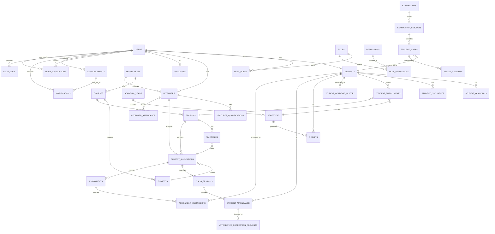

# Database Design (Microsoft SQL Server)

## 1. Conventions

- Surrogate PKs: `BIGINT IDENTITY` for internal joins.
- Human-facing unique codes (`STU2026001`, `LEC2026001`, …) are a separate indexed
  `UNIQUE` column (`public_id`), generated server-side from a configurable
  `id_sequences` table (`prefix`, `year`, `next_value`) — never the PK itself, so
  display-format changes never require touching foreign keys.
- Every table has `created_at`, `created_by`, `updated_at`, `updated_by`.
- Lifecycle tables add `status` (enum-like, backed by a lookup table) instead of
  supporting `DELETE`.
- All money/marks numeric types use `DECIMAL`, never `FLOAT`.

## 2. ER Diagram

## 3. Table Catalog

### Identity & Access
- **users**(`id` PK, `public_id` UQ, `email` UQ, `password_hash`, `status`
  [active/locked/disabled], `last_login_at`, `failed_login_count`)
- **roles**(`id`, `code` UQ [principal/admin/hod/lecturer/student/...], `name`)
- **permissions**(`id`, `code` UQ [e.g. `attendance.mark`], `description`)
- **role_permissions**(`role_id` FK, `permission_id` FK, PK(role_id, permission_id))
- **user_roles**(`user_id` FK, `role_id` FK, `scope_department_id` FK NULL — for
  dept-scoped roles like HOD, PK(user_id, role_id, scope_department_id))

### Org / Master Data
- **departments**(`id`, `public_id` UQ, `name`, `head_lecturer_id` FK NULL, `status`)
- **courses**(`id`, `public_id` UQ, `department_id` FK, `name`, `duration_years`, `status`)
- **academic_years**(`id`, `label` UQ [e.g. "2026-2027"], `start_date`, `end_date`, `is_current`)
- **semesters**(`id`, `academic_year_id` FK, `number`, `start_date`, `end_date`)
- **sections**(`id`, `course_id` FK, `year_of_study`, `name` [A/B/..], UQ(course_id, year_of_study, name))
- **subjects**(`id`, `public_id` UQ, `course_id` FK, `name`, `credits`, `max_marks_internal`, `max_marks_external`)
- **grading_scales**(`id`, `academic_year_id` FK NULL, `name`) /
  **grade_bands**(`scale_id` FK, `min_percent`, `max_percent`, `grade`, `grade_point`) — configurable grading, not hardcoded.

### People
- **students**(`id`, `user_id` FK UQ, `public_id` UQ [STU...], `admission_number` UQ,
  `first_name`, `middle_name`, `last_name`, `dob` [CHECK < today], `gender`,
  `blood_group` NULL, `mobile`, `photo_url`, `permanent_address`, `current_address`,
  `nationality`, `department_id` FK, `course_id` FK, `current_section_id` FK,
  `current_year_of_study`, `admission_date`, `previous_institution`,
  `previous_qualification`, `status` [applied/active/promoted/transferred/graduated/withdrawn/archived])
- **student_guardians**(`id`, `student_id` FK, `relationship`, `name`, `contact_number`, `email`)
- **student_documents**(`id`, `student_id` FK, `doc_type`, `file_url`, `verified_status`, `uploaded_at`)
- **student_academic_history**(`id`, `student_id` FK, `academic_year_id` FK,
  `department_id` FK, `course_id` FK, `section_id` FK, `year_of_study`, `event_type`
  [enrolled/promoted/transferred/repeated/graduated/withdrawn], `effective_date`) —
  append-only; "current" state is derived as latest row, never overwritten.
- **student_enrollments**(`id`, `student_id` FK, `semester_id` FK, `section_id` FK,
  `status`, UQ(student_id, semester_id))

- **lecturers**(`id`, `user_id` FK UQ, `public_id` UQ [LEC...], `employee_id` UQ,
  `first_name`, `last_name`, `dob`, `gender`, `mobile`, `photo_url`, `department_id` FK,
  `designation`, `employment_type`, `employment_status`, `date_of_joining`)
- **lecturer_qualifications**(`id`, `lecturer_id` FK, `degree`, `specialization`, `institution`, `year`)
- **lecturer_employment_history**(`id`, `lecturer_id` FK, `department_id` FK,
  `designation`, `start_date`, `end_date` NULL)
- **lecturer_salary**(`id`, `lecturer_id` FK UQ, `amount`, `currency`) — row-level
  access restricted to `hr.view_salary` permission only; never joined into general
  lecturer-profile queries.

- **principals**(`id`, `user_id` FK UQ, `public_id` UQ [PRI...], `employee_id` UQ,
  first/contact/qualification fields, `appointment_date`, `designation`,
  `department_id` FK NULL)

### Teaching Structure
- **subject_allocations**(`id`, `subject_id` FK, `lecturer_id` FK, `section_id` FK,
  `semester_id` FK, UQ(subject_id, section_id, semester_id))
- **class_sessions**(`id`, `allocation_id` FK, `session_date`, `period_number`,
  `status` [scheduled/held/cancelled/holiday])
- **timetables**(`id`, `allocation_id` FK, `day_of_week`, `period_number`,
  `classroom`, `academic_year_id` FK) with a unique partial constraint preventing
  (lecturer, day, period) and (classroom, day, period) and (section, day, period)
  collisions — enforced both at the DB level (filtered unique indexes) and in the
  service layer (clear error before insert attempt).

### Attendance
- **student_attendance**(`id`, `class_session_id` FK, `student_id` FK, `status`
  [present/absent/late/on_leave], `marked_by` FK users, `marked_at`,
  UQ(class_session_id, student_id))
- **attendance_correction_requests**(`id`, `student_attendance_id` FK,
  `requested_by` FK, `reason`, `requested_status`, `approval_status`
  [pending/approved/rejected], `approved_by` FK NULL, `approved_at` NULL)
- **lecturer_attendance**(`id`, `lecturer_id` FK, `date`, `check_in`, `check_out`,
  `status`, UQ(lecturer_id, date))

### Examinations
- **examinations**(`id`, `name`, `type` [internal/external], `semester_id` FK, `academic_year_id` FK)
- **examination_subjects**(`id`, `examination_id` FK, `subject_id` FK, `max_marks`, `exam_date`)
- **student_marks**(`id`, `examination_subject_id` FK, `student_id` FK, `marks_obtained`
  CHECK(marks_obtained >= 0 AND marks_obtained <= max_marks via trigger/app check),
  `entered_by` FK, `is_published`, UQ(examination_subject_id, student_id))
- **result_revisions**(`id`, `student_marks_id` FK, `previous_value`, `new_value`,
  `reason`, `changed_by` FK, `changed_at`) — publishing locks `student_marks`;
  any post-publish change inserts a revision row via an authorized revaluation
  workflow, never a silent UPDATE.
- **results**(`id`, `student_id` FK, `semester_id` FK, `total_marks`, `percentage`,
  `grade`, `status` [pass/fail/backlog], `published_at`)
- **backlogs**(`id`, `student_id` FK, `subject_id` FK, `semester_id` FK, `status` [pending/cleared])

### Assignments
- **assignments**(`id`, `allocation_id` FK, `title`, `description`, `due_date`, `max_marks`)
- **assignment_submissions**(`id`, `assignment_id` FK, `student_id` FK, `file_url`,
  `submitted_at`, `marks_obtained` NULL, `feedback` NULL, UQ(assignment_id, student_id))

### Leave
- **leave_applications**(`id`, `applicant_user_id` FK, `applicant_type`
  [student/lecturer], `leave_type`, `start_date`, `end_date`, `reason`, `status`
  [pending/approved/rejected/cancelled], `approved_by` FK NULL, `approved_at` NULL)

### Comms & Audit
- **announcements**(`id`, `author_id` FK, `title`, `body`, `scope_type`
  [college/department/section], `scope_id` NULL, `published_at`)
- **notifications**(`id`, `user_id` FK, `announcement_id` FK NULL, `type`, `payload_json`, `read_at` NULL)
- **audit_logs**(`id`, `user_id` FK, `action`, `entity_type`, `entity_id`,
  `before_json`, `after_json`, `reason` NULL, `created_at`) — never stores
  password hashes or tokens, even in `before_json`/`after_json` (redacted at the
  audit middleware before serialization).

## 4. Key Relationships & Rules

- A **student's "current" department/course/section** lives on `students` as a
  convenience denormalization for fast lookups, but the source of truth for history
  is `student_academic_history`. Any promotion/transfer writes a new history row
  *and* updates the denormalized current fields in the same transaction.
- **Attendance percentage** = present sessions / eligible sessions, where eligible
  sessions exclude `class_sessions.status IN ('cancelled','holiday')` and attendance
  rows with `status = 'on_leave'` are counted separately in reporting (shown, not
  silently folded into absent or excluded — see open question in ROADMAP.md).
- **Marks are immutable after `is_published = true`**; corrections go through
  `result_revisions` with a mandatory `reason`, requiring an authorized role.
- **No `DELETE` statements** on any of the above tables from application code;
  all "removal" is a `status` transition. (Lookup/reference tables may use
  migrations to seed/retire values, which is a schema change, not a runtime delete.)

## 5. Indexing

- Unique indexes on every `public_id`, `admission_number`, `employee_id`, `email`.
- Composite indexes for hot query paths: `(student_id, semester_id)` on marks/attendance,
  `(department_id, status)` on students/lecturers, `(allocation_id, session_date)` on class_sessions.
- Full-text or trigram index on `students.first_name + last_name` and
  `lecturers.first_name + last_name` to support partial-name search without a
  table scan.
